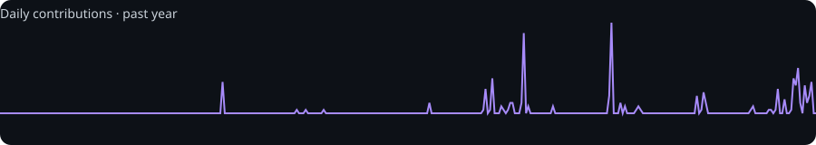

[Portfolio](https://raghavvxts.vercel.app) · [LinkedIn](https://www.linkedin.com/in/raghavvxts) · [Email](mailto:vatsraghav06@gmail.com) · [GitHub](https://github.com/raghavvxts)

Computer Science undergraduate at Bennett University (Class of 2028), based in India. I build software products across full-stack development, applied AI/ML, and connected systems.

## Featured work

### [MacDeck](https://raghavvxts.github.io/macdeck/) · [Source](https://github.com/raghavvxts/macdeck)
A browser-based companion dashboard for Mac system telemetry and media controls. Flask and `psutil` provide live data; a demo provider supports public use. Includes an installable PWA and automated browser tests.

**Stack:** Python, Flask, JavaScript, PWA, GitHub Actions

### [TerraFuse](https://github.com/raghavvxts/terrafuse-sar-optical-classification)
An applied machine learning project exploring classification with complementary SAR and optical remote-sensing data.

**Stack:** Python, machine learning, geospatial data

### [J-Town Cafe POS](https://jtowncafe.vercel.app)
Point-of-sale and billing software used in a live cafe to replace paper billing.

**Stack:** React, Node.js, Express

### More projects
- [AI Resume Analyzer](https://aianalysis-resume.vercel.app) — resume parsing, skill-gap analysis, and job matching.
- **AgriSense+** — client-distributed IoT and crop intelligence product.
- **Student Management System** — Java and MySQL academic records app with role-based access.

## Tools I use

Also: pandas, NumPy, Playwright, pytest, and GitHub Actions.

## Experience & recognition

- Independent software and product engineering projects, 2024–present.
- SmartBU Hackathon: Team ZeroGPT ranked in the top 25 of 350+ teams.
- Solved 100+ data structures and algorithms problems.

## Certifications

Google for Developers Build with AI Bootcamp · DeepLearning.AI Deep Learning Specialization · IBM Machine Learning with Python

Credential links: [LinkedIn](https://www.linkedin.com/in/raghavvxts)

## GitHub activity

The chart is generated by the profile repository’s scheduled GitHub Actions workflow.

Contribution snake

<picture>
  <source media="(prefers-color-scheme: dark)" srcset="https://raw.githubusercontent.com/raghavvxts/raghavvxts/output/github-contribution-grid-snake-dark.svg">
  <source media="(prefers-color-scheme: light)" srcset="https://raw.githubusercontent.com/raghavvxts/raghavvxts/output/github-contribution-grid-snake.svg">
  
</picture>

## Contact

[Portfolio](https://raghavvxts.vercel.app) · [LinkedIn](https://www.linkedin.com/in/raghavvxts) · [Email](mailto:vatsraghav06@gmail.com)
